# Assembly

AI-generated CAD images and instructions. Errors possible.

[PDF booklet](assembly/assembly_instructions.pdf) · [Standalone viewer](assembly/assembly_instructions.html)

1. Seat two M6 nuts in the first short frame's outer recesses. Thread in two 300 mm rods with their ends flush with the nuts.

   [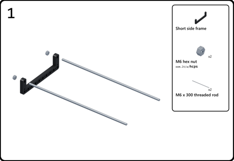](assembly/cards/step_01.png)

2. Slide a 99.67 mm spacer onto each rod. Thread an M6 nut against each spacer. Fit frame 2 with its hex recesses over the nuts.

   [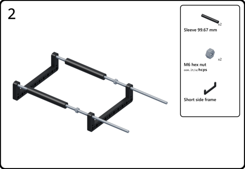](assembly/cards/step_02.png)

3. Fit a 67.67 mm spacer and an M6 nut on each rod. Seat frame 3 over the nuts. Fit the last 99.67 mm spacers with their hex pockets facing the couplings.

   [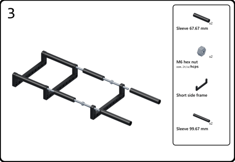](assembly/cards/step_03.png)

4. Thread an M6 nut onto each rod. Seat it flush in the last spacer’s hex pocket. Fit each coupling nut in its 18 mm housing and thread it about 6 mm onto the rod.

   [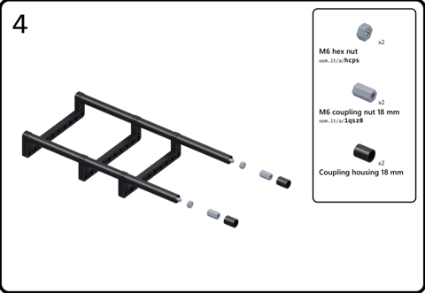](assembly/cards/step_04.png)

5. Face the final frame's recesses outward. Insert the M6 x 25 hex bolts, add retaining nuts loosely and slide the 11 mm hex covers over them. Thread the bolt tips into the couplings.

   [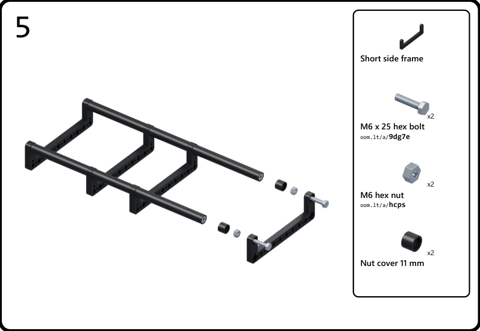](assembly/cards/step_05.png)

6. Set the width to the measured opening, nominally 335 mm. Seat the bolt heads in the outer recesses. Slide the hex covers aside, tighten the retaining nuts against the inner frame face, then replace the covers. Clip the 11 mm slotted covers over the exposed thread, slots downward. Seat the wider end 8 mm over the retaining cover.

   [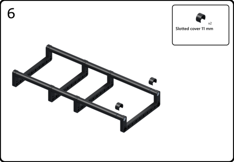](assembly/cards/step_06.png)

7. Seat two M6 nuts in the first tall frame's outer recesses. Thread in two 300 mm rods with their ends flush with the nuts.

   [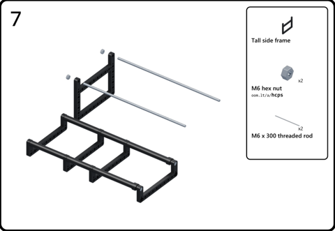](assembly/cards/step_07.png)

8. Slide a 99.67 mm spacer onto each rod. Thread an M6 nut against each spacer. Fit frame 2 with its hex recesses over the nuts.

   [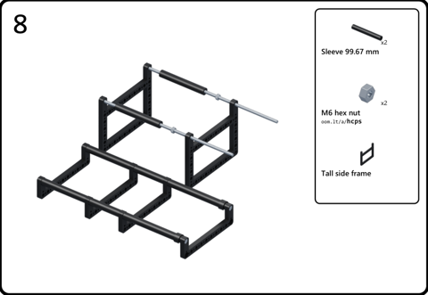](assembly/cards/step_08.png)

9. Fit a 67.67 mm spacer and an M6 nut on each rod. Seat frame 3 over the nuts. Fit the last 99.67 mm spacers with their hex pockets facing the couplings.

   [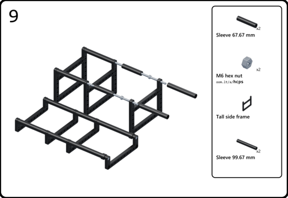](assembly/cards/step_09.png)

10. Thread an M6 nut onto each rod. Seat it flush in the last spacer’s hex pocket. Fit each coupling nut in its 18 mm housing and thread it about 6 mm onto the rod.

   [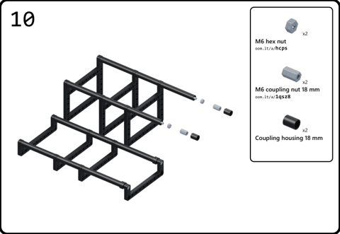](assembly/cards/step_10.png)

11. Face the final frame's recesses outward. Insert the M6 x 25 hex bolts, add retaining nuts loosely and slide the 11 mm hex covers over them. Thread the bolt tips into the couplings.

   [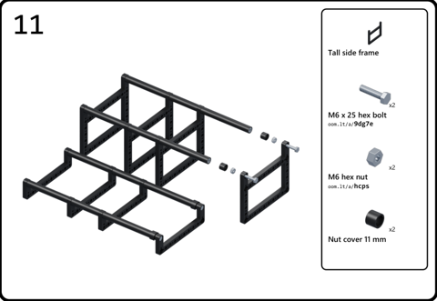](assembly/cards/step_11.png)

12. Set the width to the measured opening, nominally 335 mm. Seat the bolt heads in the outer recesses. Slide the hex covers aside, tighten the retaining nuts against the inner frame face, then replace the covers. Clip the 11 mm slotted covers over the exposed thread, slots downward. Seat the wider end 8 mm over the retaining cover.

   [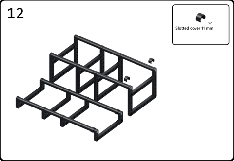](assembly/cards/step_12.png)

## Installation

Place the tall holder at the rear and the short holder at the front. Seat all feet on the shelf. Load the strapped rear refills, then the five front reels.
