# KALLAX filament holders - one cell

AI-generated CAD images and instructions. Errors possible.

[Assembled OpenSCAD model](3dpr.scad) | [P1S print project](kallax_one_cell_p1s.3mf) | [PDF booklet](assembly/assembly_instructions.pdf) · [Standalone HTML viewer](assembly/assembly_instructions.html) · [Full BOM](assembly/parts.csv)

## Summary

3D-printable holders for storing 3D printer filament in an IKEA KALLAX shelving unit. One cell holds five reels at the front and five strapped filament refills without spools on a raised rear row. This repository includes printable files, editable source and illustrated assembly instructions.

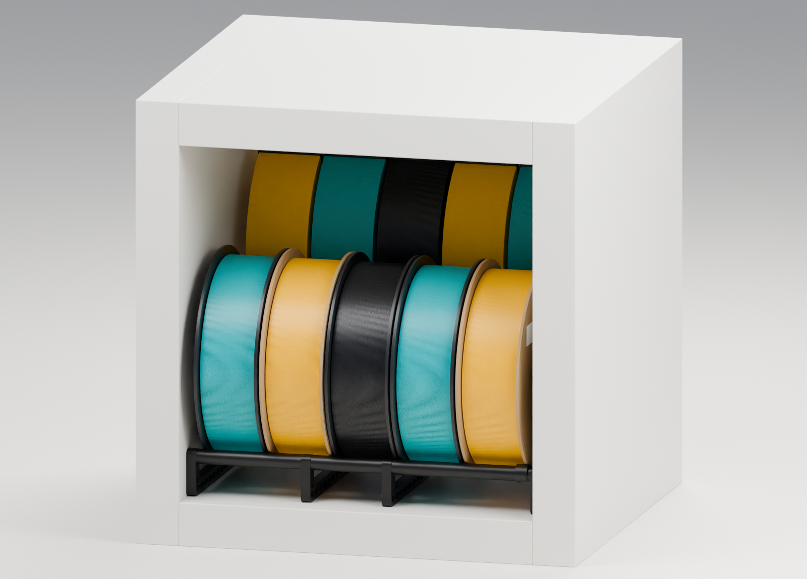

## Details

The P1S project contains three plates. Print plate 1 once for the short frames and spacers, then plates 2 and 3 once each for the tall frames. Use slot 1 (black PLA).

Two independent holders. Four short frames at the front; four tall frames at the rear. Nominal width: 335 mm. Rail heights: 37 / 112 mm. Row centres: 187 mm. Print all plastic parts in black. Physical fit and load capacity are untested.

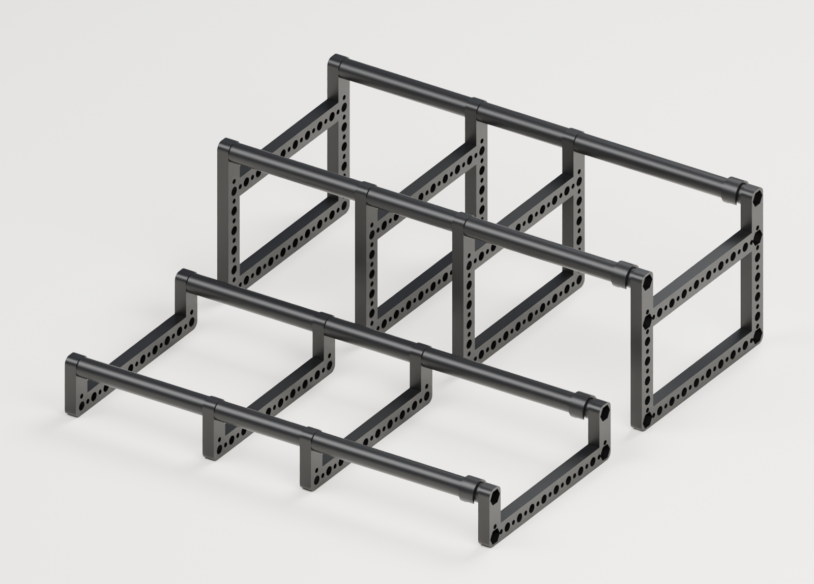

Two cells in a 4 x 4 KALLAX unit; double the quantities below.

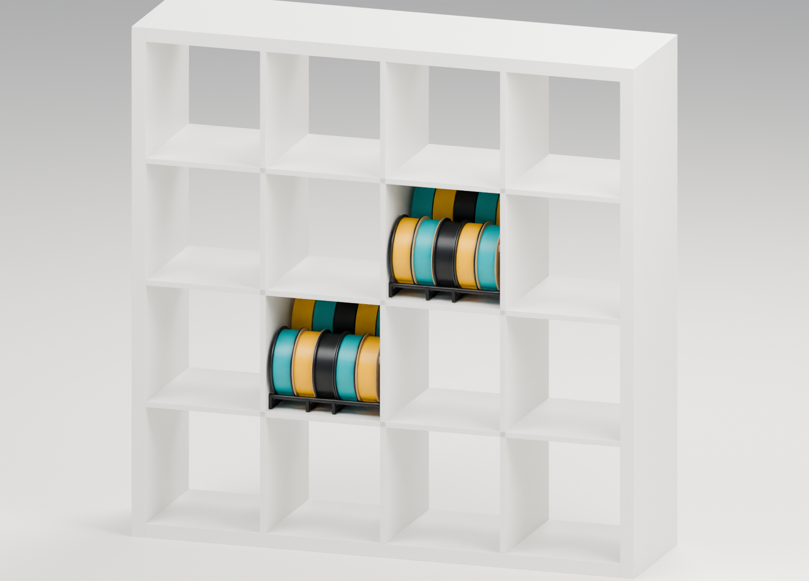

## Parts

One complete cell. Short holder shown exploded; the rear uses tall frames.

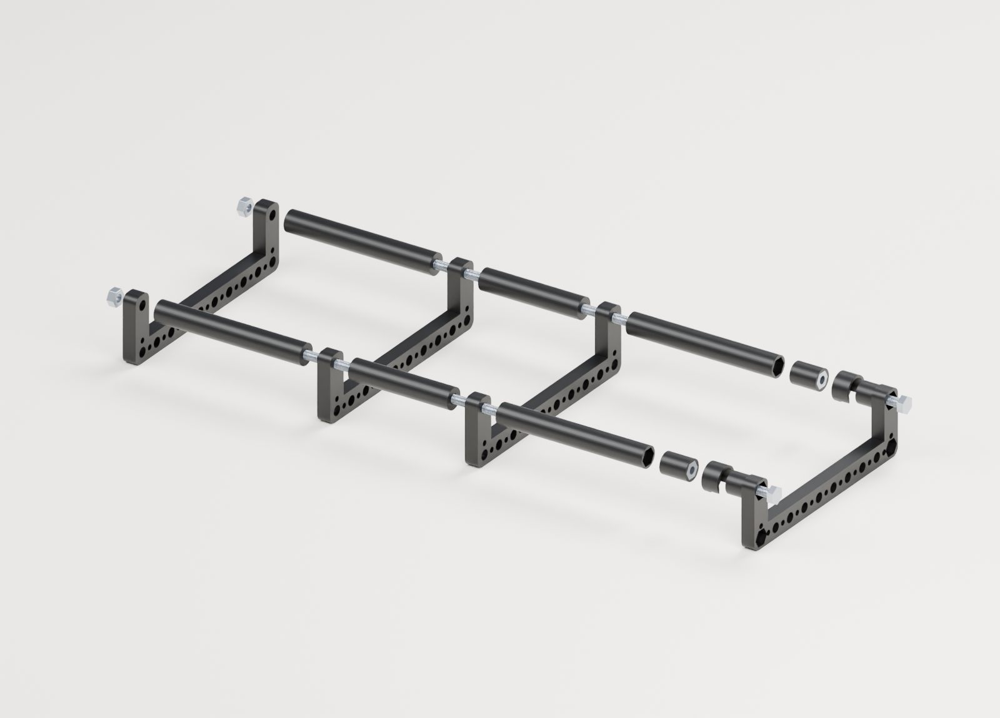

### Printed parts

| Part | Size | Qty. | Print file |
| --- | --- | ---: | --- |
| Short side frame | 149 x 44 x 9 mm | 4 | [STL](print/P1.stl) |
| Tall side frame | 149 x 119 x 9 mm | 4 | [STL](print/P2.stl) |
| Sleeve 99.67 mm | 99.67 mm long; one-end hex pocket | 8 | [STL](print/P3.stl) |
| Sleeve 67.67 mm | 67.67 mm long; one-end hex pocket | 4 | [STL](print/P4.stl) |
| Coupling housing 18 mm | 18 mm long; full hex bore | 4 | [STL](print/P5.stl) |
| Nut cover 11 mm | 11 mm long; full hex bore | 4 | [STL](print/P6.stl) |
| Slotted cover 11 mm | 11 mm long; 8 mm overlap socket | 4 | [STL](print/P7.stl) |

### Hardware

| Part | Specification | Qty. | OOMP ID | Code |
| --- | --- | ---: | --- | --- |
| M6 x 300 threaded rod | 300 mm cut length; M6 x 1.0 | 4 | OOMP record pending | - |
| [M6 hex nut](https://github.com/oomlout/oomp_hardware_bolt_version_5/tree/main/parts/hardware_nut_m6) | 10 mm AF; 5 mm nominal thickness | 8 | [hardware_nut_m6](https://github.com/oomlout/oomp_hardware_bolt_version_5/tree/main/parts/hardware_nut_m6) | [hcps](https://oom.lt/a/hcps) |
| [M6 coupling nut 18 mm](https://github.com/oomlout/oomp_hardware_bolt_version_5/tree/main/parts/hardware_nut_m6_coupling) | DIN 6334; 18 mm long; 10 mm AF | 4 | [hardware_nut_m6_coupling](https://github.com/oomlout/oomp_hardware_bolt_version_5/tree/main/parts/hardware_nut_m6_coupling) | [1qsz8](https://oom.lt/a/1qsz8) |
| [M6 x 25 hex bolt](https://github.com/oomlout/oomp_hardware_bolt_version_5/tree/main/parts/hardware_set_screw_m6_25_mm_length) | 25 mm under head; M6 x 1.0; DIN 933 | 4 | [hardware_set_screw_m6_25_mm_length](https://github.com/oomlout/oomp_hardware_bolt_version_5/tree/main/parts/hardware_set_screw_m6_25_mm_length) | [9dg7e](https://oom.lt/a/9dg7e) |

Bolt length is measured under the head. Threaded rod: OOMP record pending.

## Assembly

Cut and deburr four 300 mm M6 rods. Prepare a 10 mm spanner. Steps 1-6 build the short holder; steps 7-12 build the tall holder.

1. Seat two M6 nuts in the first short frame's outer recesses. Thread in two 300 mm rods with their ends flush with the nuts.

   [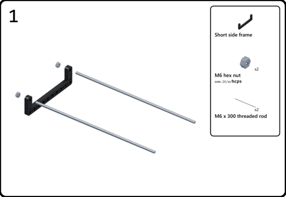](assembly/cards/step_01.png)

2. Slide one 99.67 mm sleeve onto each rod, then fit the second frame.

   [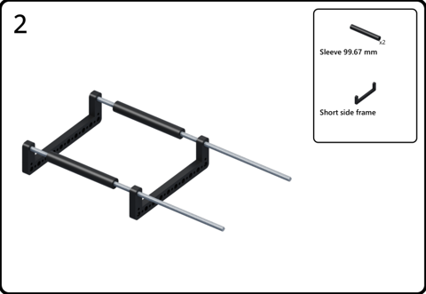](assembly/cards/step_02.png)

3. Fit two 67.67 mm sleeves, the third frame and two 99.67 mm sleeves. Face the last sleeves' hex pockets toward the couplings.

   [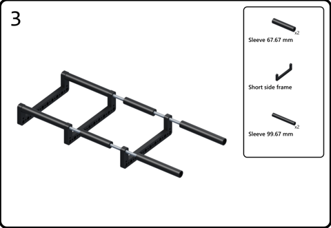](assembly/cards/step_03.png)

4. Insert an M6 coupling nut into each 18 mm housing. Thread each coupling approximately 6 mm onto its rod.

   [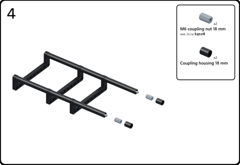](assembly/cards/step_04.png)

5. Face the final frame's recesses outward. Insert the M6 x 25 hex bolts, add retaining nuts loosely and slide the 11 mm hex covers over them. Thread the bolt tips into the couplings.

   [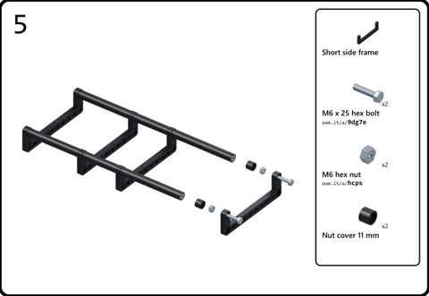](assembly/cards/step_05.png)

6. Set the width to the measured opening, nominally 335 mm. Seat the bolt heads in the outer recesses. Slide the hex covers aside, tighten the retaining nuts against the inner frame face, then replace the covers. Clip the 11 mm slotted covers over the exposed thread, slots downward. Seat the wider end 8 mm over the retaining cover.

   [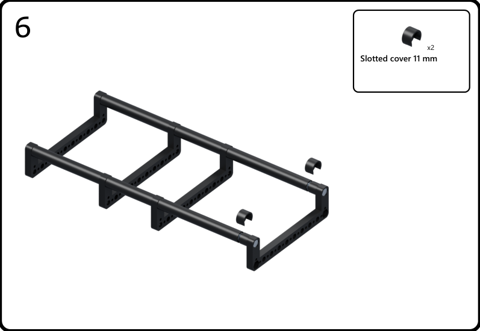](assembly/cards/step_06.png)

7. Seat two M6 nuts in the first tall frame's outer recesses. Thread in two 300 mm rods with their ends flush with the nuts.

   [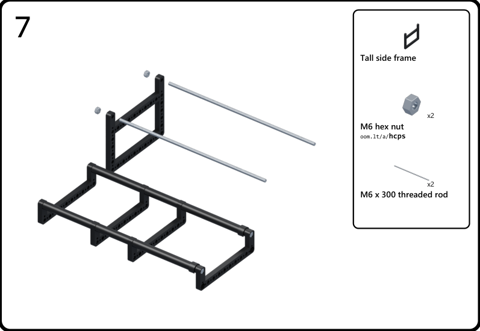](assembly/cards/step_07.png)

8. Slide one 99.67 mm sleeve onto each rod, then fit the second frame.

   [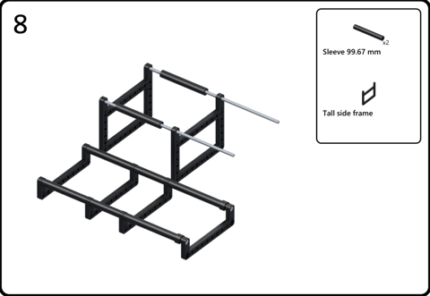](assembly/cards/step_08.png)

9. Fit two 67.67 mm sleeves, the third frame and two 99.67 mm sleeves. Face the last sleeves' hex pockets toward the couplings.

   [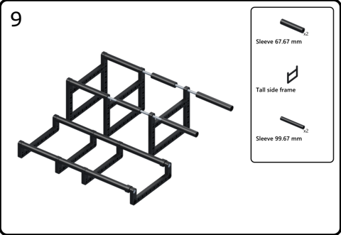](assembly/cards/step_09.png)

10. Insert an M6 coupling nut into each 18 mm housing. Thread each coupling approximately 6 mm onto its rod.

   [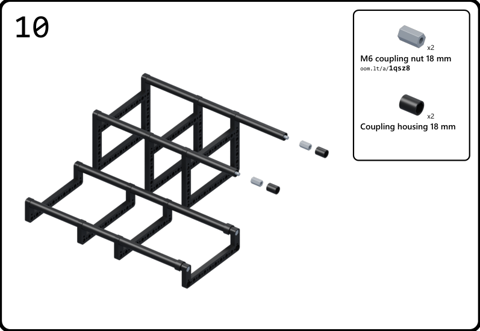](assembly/cards/step_10.png)

11. Face the final frame's recesses outward. Insert the M6 x 25 hex bolts, add retaining nuts loosely and slide the 11 mm hex covers over them. Thread the bolt tips into the couplings.

   [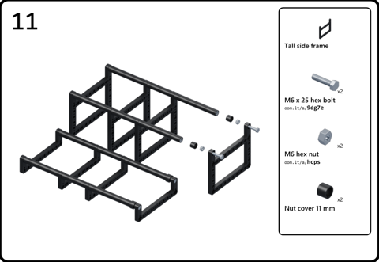](assembly/cards/step_11.png)

12. Set the width to the measured opening, nominally 335 mm. Seat the bolt heads in the outer recesses. Slide the hex covers aside, tighten the retaining nuts against the inner frame face, then replace the covers. Clip the 11 mm slotted covers over the exposed thread, slots downward. Seat the wider end 8 mm over the retaining cover.

   [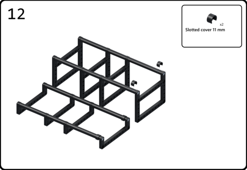](assembly/cards/step_12.png)

### Installation

Place the tall holder at the rear and the short holder at the front. Seat all feet on the shelf. Load the strapped rear refills, then the five front reels.

The 11 mm clip seats 8 mm over the 11 mm retaining cover. The two pieces span 14 mm together.

Per rail: one coupling; one fixed nut; one retaining nut; one 25 mm bolt. Nominal engagement: rod 5.99 mm, bolt 7 mm. A different span requires a revised slotted cover and an engagement check.
