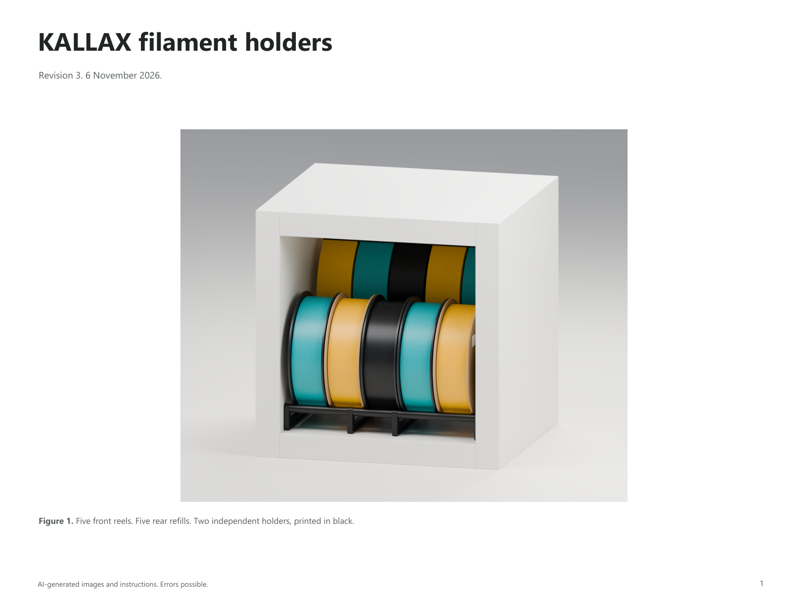

# KALLAX presentation package

README layout 4, 7 November 2026. The assembly geometry and seven-page PDF remain revision 3. Agent handoff and build notes follow.

The checkout is now at `C:\gh\three_d_printing_filament_storage_kallax_holder`
(moved 7 November 2026). Build scripts resolve their inputs and outputs from their
own location. README previews, source-file references and Blender render targets
use relative paths so the package can move with the checkout.

Revision 3 combines printed parts and hardware in one BOM, adds verified MD5 alpha links and shortens the published copy. [source-notes.json](source-notes.json) retains the full draft. [scripts/revise_text.py](scripts/revise_text.py) applies the final editorial pass after configuration. Geometry is unchanged from revision 2.

**AI-generated documentation.** The CAD illustrations, section drawing, instructions and scripts were created with AI assistance and may contain mistakes. The project has not been physically assembled or load-tested as part of this work.

## Published files

- [Assembly guide](assembly-guide.pdf), seven pages.
- [Parts list](parts.csv), quantities for one and two cells.
- [Root README](../readme.md), illustrated assembly and installation instructions with OOMP links.
- [Published images](images), including the individual guide pages and end-section drawing. Each carries an AI notice.
- [Research notes](research.md), source links and style decisions.
- [Assembly data](project.json), the reviewed BOM, specifications, links and dimensional stack.



## Assembly revision

Each cell has four short frames and four tall frames. The two holders are independent and each has two 300 mm M6 rods. Each rail has one fixed-end M6 nut, one 18 mm coupling nut, one M6 x 25 fully threaded hex-head bolt and one additional M6 nut retaining that bolt against the final frame.

The retaining nut is on the inside of the final frame. Its 7 mm full-hex cover occupies the last 7 mm before the frame and encloses the nominal 5 mm nut plus 2 mm of adjacent thread. The slotted cover between that cover and the coupling is now 7 mm. Both covers are existing production parts. The previous 14 mm cover is superseded for this assembly; it is retained as historical source geometry, not listed in the active BOM.

The final frame is reversed so its hex recess faces outward. The fixed-end nut and bolt head sit inside the respective outer pockets. Set the bolt length before tightening its retaining nut; the locked assembly is not a turnbuckle.

## Dimensions and evidence

| Item | Value or status |
| --- | --- |
| Printed parts per cell | 32 |
| Purchased hardware per cell | 20 pieces |
| Nominal width | 335.01 mm |
| Source sleeve total | 99.67 + 67.67 + 99.67 = 267.01 mm |
| Side-frame total | 4 x 9 = 36 mm |
| End covers and housing | 18 + 7 + 7 = 32 mm |
| Bolt length | 25 mm under head |
| Nominal engagement | Rod 5.99 mm; bolt 7 mm |
| Nominal clearance between tips | 5.01 mm |
| Source geometry | Existing STL parts imported at millimetre scale |
| OOMP hardware identity | Nut, coupling and full-thread hex-head set-screw entries checked |
| Exact OOMP 300 mm rod record | Not verified; cut stock is specified directly |
| Furniture opening | 335 mm assumed, not measured |
| Physical fit, snap fit and load capacity | Untested |

The nominal span is not a guaranteed clearance fit. Measure the actual cabinet and hardware. Thread engagement values exclude losses from chamfers and thread runout. The source hex pockets are 5 mm deep; the hardware illustration assumes a 4 mm bolt head and 5 mm ordinary nuts.

The cabinet and filament rolls are illustrative geometry. The 4 x 4 shell is 1470 x 1470 x 390 mm; IKEA's current page gives a 1465 mm product height. The source model was retained as a setting, not presented as a furniture manufacturing drawing. Front reels are generic 200 x 60 mm, rear refills 200 x 58 mm, with five at 62 mm centres. Black holder materials override the default OOBB palette; teal, yellow and black remain on the illustrated filament.

## Rebuild

The main README now uses Summary, Details, Parts and Assembly. Summary shows the installed system; Details hides all steel hardware and shows assembled printed parts only. Parts uses the exploded short holder and a complete hardware-only table for one cell. Assembly has six numbered actions with generated 480 px thumbnails linked to full-size images. Printed-part quantities remain in the full CSV and PDF.

Hardware IDs and alpha codes were checked in the public `oomp_hardware_bolt_version_5` records on 2026-11-07. Names and IDs use those OOMP pages; codes use the requested `https://oom.lt/a/{code}` format. The web verification tool could not access the short URLs, so their live redirects are not claimed verified. The M6 rod is explicitly pending, as requested by the user; no supplier link is substituted.

```powershell
# Apply this project's four-section wording and hardware-link policy.
python presentation/scripts/readme_layout.py

# Rebuild README, published images, thumbnails and CSV; retain the existing PDF.
python presentation/scripts/build.py --readme-only

# Render the four README-specific views first.
python presentation/scripts/build.py --readme-only --render --blender 'C:/Program Files/Blender Foundation/Blender 5.2/blender.exe'
```

The older `revise_text.py` is historical and refuses to overwrite the current layout. Use `readme_layout.py` or edit `project.json` directly. New views are `printed`, `step-fixed`, `step-sleeves` and `step-coupling`; the last two assembly actions reuse the section drawing and in-use view. Source notes retain the longer engineering text. The shared contract and template live in the OOBB base repository's `presentation/` folder.

The local CommonMark preview was inspected at desktop and 390 px widths on 2026-11-07. Numbering remains continuous, thumbnails fit the text column and the hardware table scrolls horizontally on narrow screens. Clicking the first 480 px thumbnail opened its 2400 × 1470 px source. All four headings, local image links and six thumbnail files passed the package validator. `scripts/preview_readme.py` creates HTML only; inspect that preview with the browser.

Run these commands from the project root. The Python scripts resolve paths from their own locations, so absolute script paths also work from another working directory.

```powershell
# Rebuild text, PDF, CSV, labelled images and copies beside active catalogue STLs.
python presentation/scripts/build.py

# Rebuild all seven CAD views first, then the presentation package.
python presentation/scripts/build.py --render --blender 'C:/Program Files/Blender Foundation/Blender 5.2/blender.exe'

# Read-only checks of actual saved scene counts and recessed hardware positions.
& 'C:/Program Files/Blender Foundation/Blender 5.2/blender.exe' --background --python-exit-code 1 --python presentation/scripts/audit_scene.py

# Validate local README links, images, quantities and PDF text bounds.
python presentation/scripts/lib/validate_presentation.py .
```

Requirements: Python with ReportLab, Pillow and PyMuPDF; Blender 5.2 for CAD rendering. The CAD geometry audit runs in Blender. Source-mesh validation additionally uses trimesh and NumPy. See [requirements.txt](requirements.txt).

`scripts/configure.py` records the reviewed assembly and writes `project.json`. It is not run during a normal rebuild. Edit the manifest directly or update and run this configuration script deliberately. The renderer asserts its supported dimensions; a different axial stack needs corresponding transform and section-drawing updates.

The reusable helpers are vendored in `scripts/lib/` and the README template in `templates/`. Their source is the base OOBB repository's `presentation/` folder. Copy updated helpers deliberately and review the result; project builds do not depend on an absolute path to that repository.

## Validation and source records

- [Package validation](qa/validation.json): links, quantities, published images and PDF bounds.
- [Scene audit](qa/scene-audit.json): expected repeated parts and fastener positions in the saved scenes.
- [Source mesh audit](qa/source-meshes.json): exact STL hashes, extents and watertight status.
- [Hardware source checks](qa/hardware-links.json): inspected public records and dimensional reference.
- [Visual contact sheet](qa/contact-sheet.png): all current guide pages.

Review the full-size page PNGs as well as the contact sheet. These checks are digital, not a successful assembly test. Printed material selection, print settings, tightening torque, hardware access and load capacity are not established here.

## File ownership and older outputs

`../render_kallax.py` is the current CAD renderer. `scripts/build.py` controls page composition and published outputs. The root `make_visual_guide.py` is a compatibility entry point for the current builder. The old PDF download path under `output/pdf/` is updated to the current guide.

The previous `renders/` outputs are historical and should not be used in a new README. The active `parts/` folders receive the current assembled, exploded, parts-list, assembly and end-detail PNGs. The old 14 mm variant is not regenerated by this workflow. No source production STL was changed in revision 2.
