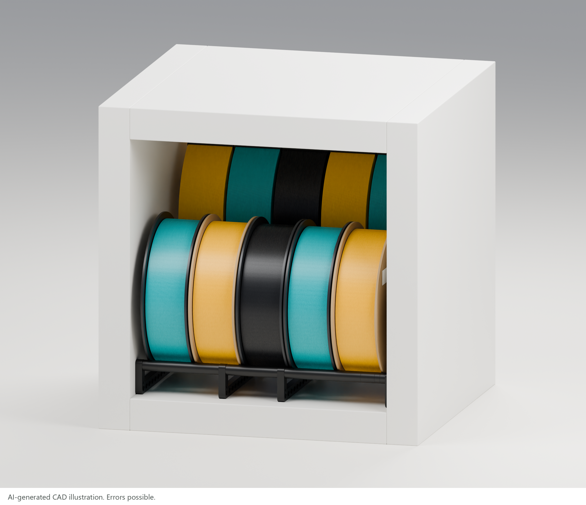
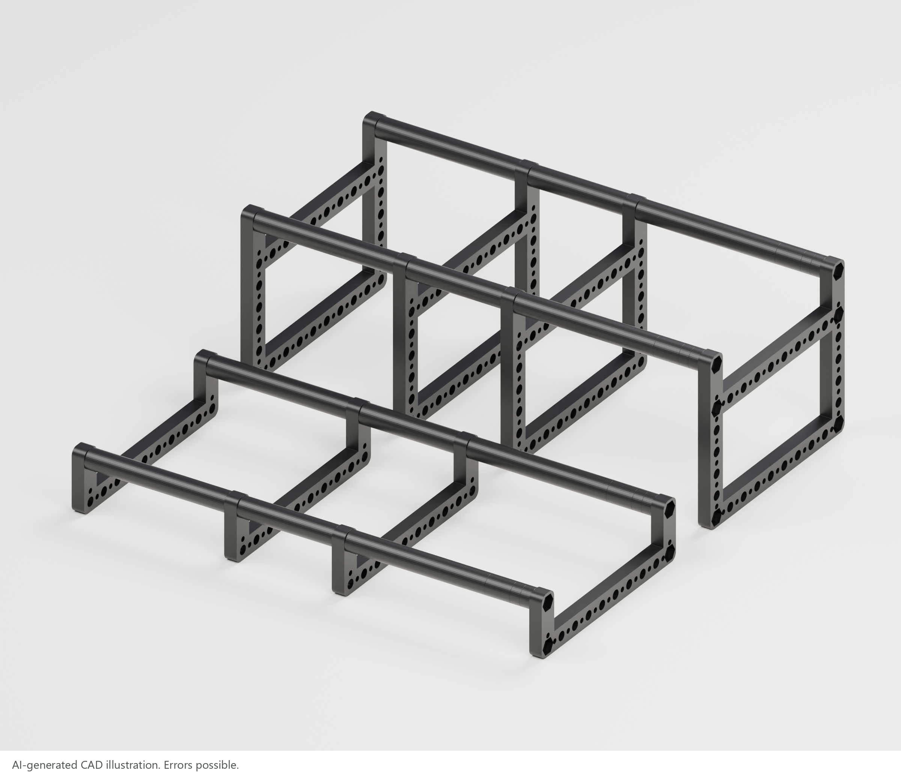
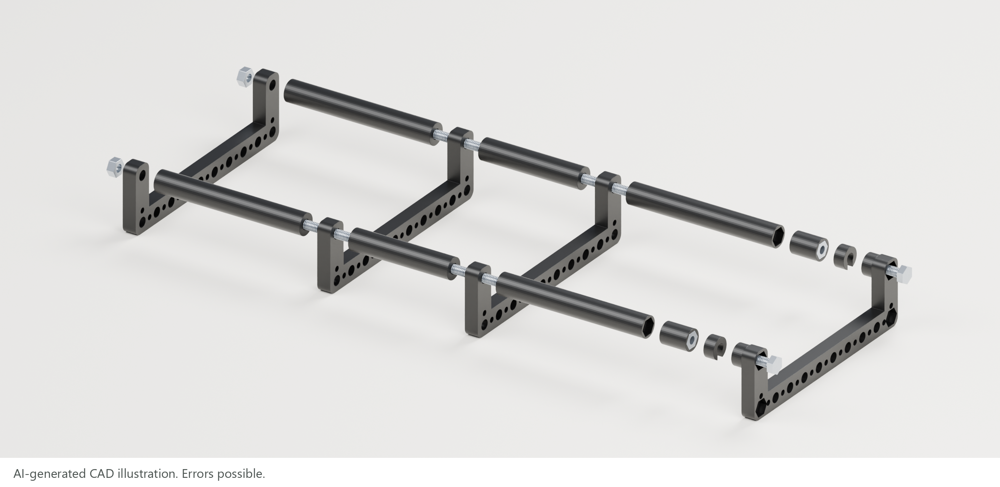
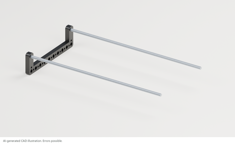
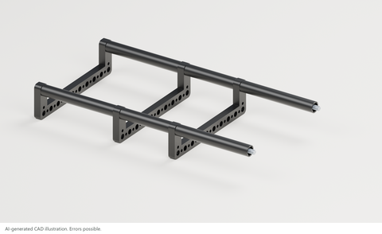
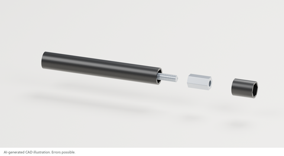
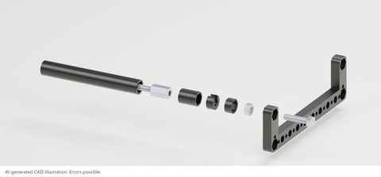

<!-- oobb-presentation:start -->
# KALLAX filament holders

AI-generated images and instructions. Errors possible.

## Summary

This project provides 3D-printable holders for storing 3D printer filament in an IKEA KALLAX shelving unit. Two holders store five reels at the front and five filament refills without spools on a raised row at the back.

## Details

Each holder uses four side frames and two adjustable M6 rails. The short and tall holders are independent. Nominal width: 335 mm. Rail heights: 37 and 112 mm. Print all 32 plastic pieces in black.

[Print files](parts) · [Full BOM](presentation/parts.csv) · [Assembly guide](presentation/assembly-guide.pdf) · [Build notes](presentation/README.md)

## Parts

Short holder shown. The rear holder uses tall frames.

Hardware quantities for one complete cell. Double for two cells.

| Ref. | Part | Specification | Qty. | OOMP ID | Code |
| --- | --- | --- | ---: | --- | --- |
| H1 | M6 threaded rod | 300 mm cut length; M6 x 1.0 | 4 | Pending | — |
| H2 | [M6 hex nut](https://github.com/oomlout/oomp_hardware_bolt_version_5/tree/main/parts/hardware_nut_m6) | 10 mm AF; 5 mm nominal thickness | 8 | [`hardware_nut_m6`](https://github.com/oomlout/oomp_hardware_bolt_version_5/tree/main/parts/hardware_nut_m6) | [hcps](https://oom.lt/a/hcps) |
| H3 | [M6 coupling nut](https://github.com/oomlout/oomp_hardware_bolt_version_5/tree/main/parts/hardware_nut_m6_coupling) | DIN 6334; 18 mm long; 10 mm AF | 4 | [`hardware_nut_m6_coupling`](https://github.com/oomlout/oomp_hardware_bolt_version_5/tree/main/parts/hardware_nut_m6_coupling) | [1qsz8](https://oom.lt/a/1qsz8) |
| H4 | [M6 x 25 hex-head bolt, fully threaded](https://github.com/oomlout/oomp_hardware_bolt_version_5/tree/main/parts/hardware_set_screw_m6_25_mm_length) | 25 mm under head; M6 x 1.0; DIN 933 | 4 | [`hardware_set_screw_m6_25_mm_length`](https://github.com/oomlout/oomp_hardware_bolt_version_5/tree/main/parts/hardware_set_screw_m6_25_mm_length) | [9dg7e](https://oom.lt/a/9dg7e) |

Threaded rod: OOMP record pending.

## Assembly

1. Cut and deburr four 300 mm M6 rods. Seat two M6 nuts in a short frame’s outer recesses. Thread in two rods with their ends flush.

   

2. On both rods, fit a 99.67 mm sleeve, second frame, 67.67 mm sleeve, third frame and 99.67 mm sleeve. Face the last sleeve’s hex pocket toward the coupling.

   

3. Insert each M6 coupling nut into an 18 mm housing. Thread it onto the rod by approximately 6 mm.

   

4. Face the final frame’s hex recesses outward. Insert the M6 × 25 mm bolts. Add retaining nuts loosely, then slide on the 7 mm hex covers. Thread the bolts into the couplings.

   

5. Set the span to the measured opening; nominally 335 mm. Seat the bolt heads in their recesses. Tighten the retaining nuts against the inner frame face, replace the hex covers and clip the 7 mm slotted covers over the exposed thread.

   

6. Repeat with four tall frames. Place the tall holder at the rear and the short holder at the front. Load strapped rear refills, then front reels.

   
<!-- oobb-presentation:end -->
