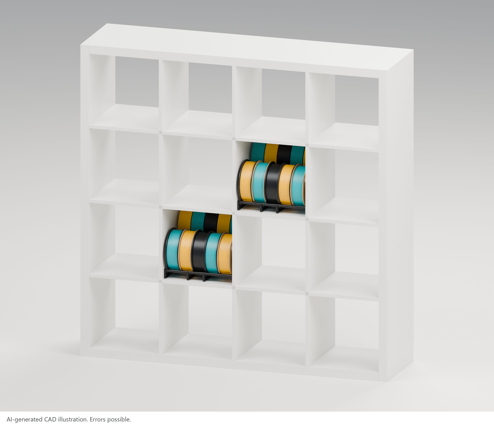
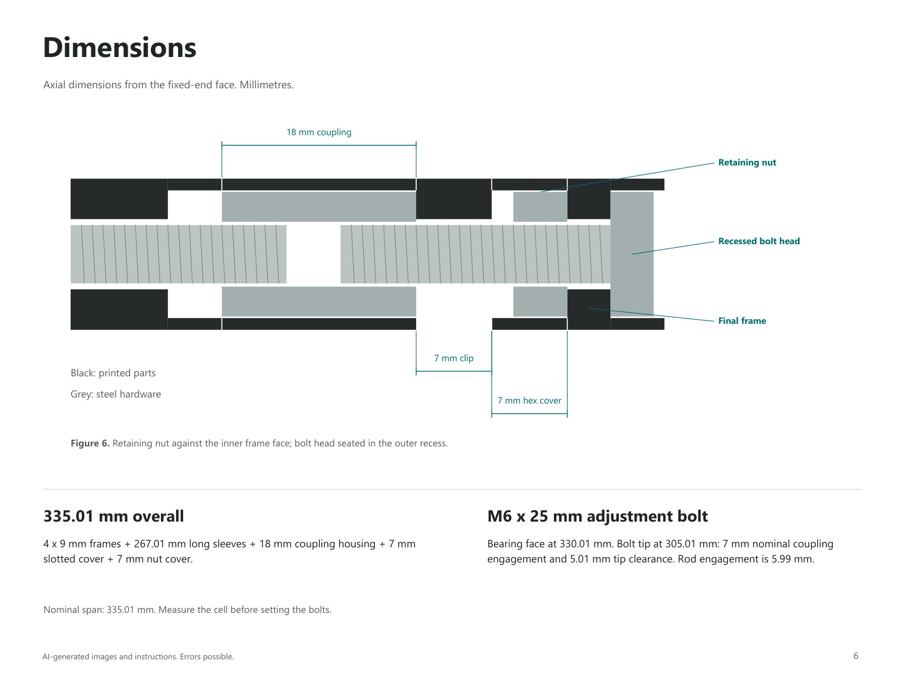

<!-- oobb-presentation:start -->
# KALLAX filament holders

Two independent holders per KALLAX cell: five front reels and five raised rear refills. Four side frames and two M6 rails per holder.

*AI-generated images and instructions. Errors possible.*

[Guide (PDF)](presentation/assembly-guide.pdf) · [BOM (CSV)](presentation/parts.csv) · [Build notes](presentation/README.md)

## Configuration

Front: 4 short frames. Rear: 4 tall frames. Rail heights: 37 / 112 mm. Row centres: 187 mm. Nominal cell width: 335 mm.

Illustrated rolls: front diameter 200 x 60 mm wide; rear diameter 200 x 58 mm wide. Five rolls at 62 mm centres occupy 308 mm.

## Parts

Quantities are for one complete cell. Double for two cells. Print all 32 plastic parts in black.

| Ref. | Type | Part | Specification | Qty. | MD5 alpha |
| --- | --- | --- | --- | ---: | --- |
| P1 | Print | [Short side frame](parts/project_github_oomlout_three_d_printing_filament_storage_kallax_side_10_width_3_height_9_mm_depth_short_extra/3dpr.stl) | 149 x 44 x 9 mm | 4 | - |
| P2 | Print | [Tall side frame](parts/project_github_oomlout_three_d_printing_filament_storage_kallax_side_10_width_8_height_9_mm_depth_short_extra/3dpr.stl) | 149 x 119 x 9 mm | 4 | - |
| P3 | Print | [Long sleeve](parts/project_github_oomlout_three_d_printing_filament_storage_kallax_spacer_1_width_1_height_99_67_mm_depth_one_end_nut_extra/3dpr.stl) | 99.67 mm long; one-end hex pocket | 8 | - |
| P4 | Print | [Centre sleeve](parts/project_github_oomlout_three_d_printing_filament_storage_kallax_spacer_1_width_1_height_67_67_mm_depth_one_end_nut_extra/3dpr.stl) | 67.67 mm long; one-end hex pocket | 4 | - |
| P5 | Print | [Coupling housing](parts/project_github_oomlout_three_d_printing_filament_storage_kallax_spacer_1_width_1_height_18_mm_depth_full_nut_extra/3dpr.stl) | 18 mm long; full hex bore | 4 | - |
| P6 | Print | [Retaining nut cover](parts/project_github_oomlout_three_d_printing_filament_storage_kallax_spacer_1_width_1_height_7_mm_depth_full_nut_extra/3dpr.stl) | 7 mm long; full hex bore | 4 | - |
| P7 | Print | [Slotted cover](parts/project_github_oomlout_three_d_printing_filament_storage_kallax_spacer_1_width_1_height_7_mm_depth_slotted_extra/3dpr.stl) | 7 mm long; open slot | 4 | - |
| H1 | Hardware | [M6 threaded rod](https://www.ecfibreglasssupplies.co.uk/grade-48-zinc-threaded-rod-m6-x-300-mm) | 300 mm cut length; M6 x 1.0 | 4 | - |
| H2 | Hardware | [M6 hex nut](https://github.com/oomlout/oomlout_oomp_version_1_messy/tree/main/parts/hardware_nut_m6) | 10 mm AF; 5 mm nominal thickness | 8 | [hcps](https://github.com/oomlout/oomlout_oomp_version_1_messy/tree/main/parts/hardware_nut_m6) |
| H3 | Hardware | [M6 coupling nut](https://github.com/oomlout/oomlout_oomp_version_1_messy/tree/main/parts/hardware_nut_m6_coupling) | DIN 6334; 18 mm long; 10 mm AF | 4 | [1qsz8](https://github.com/oomlout/oomlout_oomp_version_1_messy/tree/main/parts/hardware_nut_m6_coupling) |
| H4 | Hardware | [M6 x 25 hex-head bolt, fully threaded](https://github.com/oomlout/oomp_hardware_bolt_version_5/tree/main/parts/hardware_set_screw_m6_25_mm_length) | 25 mm under head; M6 x 1.0; DIN 933 | 4 | [9dg7e](https://github.com/oomlout/oomp_hardware_bolt_version_5/tree/main/parts/hardware_set_screw_m6_25_mm_length) |

Click an MD5 alpha code for its OOMP record. H2 includes fixed and retaining nuts. H4 is a fully threaded hex-head set screw.

## Preparation

Measure the opening. Check the 5 mm hex pockets against the nuts and bolt heads. Cut and deburr four 300 mm M6 rods. Prepare a 10 mm spanner.

## Assembly

1. Seat two H2 nuts in the first frame's outer hex pockets. Thread in H1 rods; keep the ends flush.

2. Fit both rails in this order: P3 sleeve / second frame / P4 sleeve / third frame / P3 sleeve. Face the last sleeve's hex pocket toward the coupling.

3. Insert H3 couplings into P5 housings. Thread onto the rods to approximately 6 mm engagement.

4. Face the final frame's hex pockets outward. Insert H4 bolts. Add H2 retaining nuts loosely. Slide P6 hex covers onto the bolts.

5. Thread H4 into H3. Set the span. Seat the bolt heads. Slide P6 aside, tighten H2 against the inner frame face, then cover the nuts.

6. Clip P7 over each exposed thread section. Check all end fasteners are recessed. Repeat with tall frames.

## Adjustment

Per rail: one 18 mm coupling, one M6 x 25 bolt, one retaining M6 nut, one 7 mm hex cover and one 7 mm slotted cover.

To adjust: remove P7; slide P6 aside; loosen H2; release the bolt head from its recess; turn H4. Reseat the head, tighten H2 and refit both covers.

## Installation

1. Place the tall holder at the rear and the short holder at the front. Seat all feet on the shelf.

2. Check width and fastener seating before loading. Do not force the cabinet sides apart.

3. Load strapped rear refills, then front reels. Check clearance and frame stability.

## Dimensions

Nominal rail stack: `4 x 9 + 2 x 99.67 + 67.67 + 18 + 7 + 7 = 335.01 mm`.

M6 x 25 bolt: 7 mm nominal coupling engagement; 5.01 mm tip clearance. Rod engagement: 5.99 mm. Slotted cover length for another opening: `opening - 328.01 mm`; recheck engagement before use.

## Sources

[STL files](scad_output) · [Catalogue parts](parts) · [Coupling dimensions](https://www.accu.co.uk/hexagonal-stud-connector-nuts/62290-HTBN-M6-A2) · [KALLAX reference](https://www.ikea.com/gb/en/p/kallax-shelving-unit-white-30275861/) · [Research notes](presentation/research.md)
<!-- oobb-presentation:end -->
