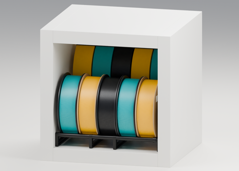

# KALLAX filament holders

3D-printable holders for storing 3D printer filament in an IKEA KALLAX shelving unit. One cell holds five reels at the front and five strapped filament refills without spools on a raised rear row. This repository includes printable files, editable source and illustrated assembly instructions.

This is an entirely AI-generated coding project. The source code is largely unreadable by humans, but usable generated files are included. It is published so others can use their own AI tools to understand, modify and regenerate the design. Physical fit and load capacity have not been tested.

> AI-generated CAD images and instructions. Errors possible.

## Versions

| Image | Version and description | Main README | HTML assembly instructions | PDF download |
| --- | --- | --- | --- | --- |
|  | [**One cell kit**](parts/project_github_oomlout_three_d_printing_filament_storage_kallax_one_cell_kit/README.md) Four short and four tall frames; four adjustable M6 rails. Five front reels and five rear refills. | [Assembly](parts/project_github_oomlout_three_d_printing_filament_storage_kallax_one_cell_kit/README.md#assembly) | Hosting pending · [Download HTML](parts/project_github_oomlout_three_d_printing_filament_storage_kallax_one_cell_kit/assembly/assembly_instructions.html) | [Download PDF](parts/project_github_oomlout_three_d_printing_filament_storage_kallax_one_cell_kit/assembly/assembly_instructions.pdf) |
